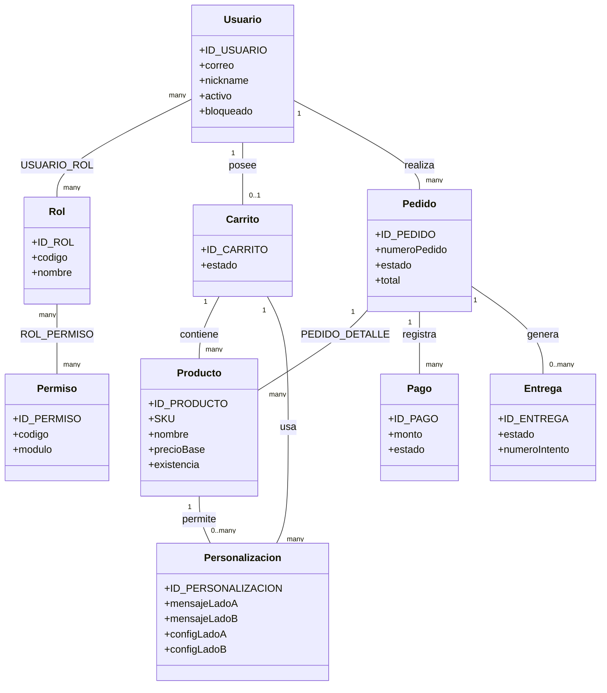
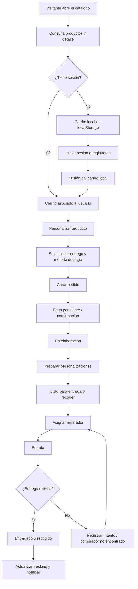

# Manual técnico y funcional — FamKon Store

## 1. Propósito del documento

Este documento resume la arquitectura, las tecnologías, los servicios, la base de datos, los flujos principales y el modelo de roles de **FamKon Store**. Está dirigido a desarrolladores, administradores y personal encargado de operar o mantener la tienda en línea.

## 2. Descripción general

FamKon Store es una tienda web para consultar productos, personalizarlos, agregarlos al carrito, crear pedidos, registrar pagos y dar seguimiento a las entregas. La solución está dividida en tres capas principales:

| Capa | Tecnología | Responsabilidad |
|---|---|---|
| Frontend | React 19, TypeScript, Vite, Tailwind CSS 4 | Interfaz web, navegación, validaciones, sesión y experiencia del usuario |
| Backend | ASP.NET Core 8 Web API, C# | API REST, autenticación, autorización, reglas de aplicación e integración con servicios externos |
| Base de datos | Oracle Database 21c, SQL y PL/SQL | Persistencia, integridad, transacciones, paquetes de negocio, triggers y auditoría |

La aplicación se publica mediante **Nginx**: sirve el frontend compilado y redirige `/api` hacia la API. El backend se conecta a Oracle mediante `Oracle.ManagedDataAccess.Core`.

## 3. Tecnologías y servicios utilizados

### 3.1 Frontend

- **React 19** y **React DOM** para la interfaz.
- **TypeScript** con compilación estricta.
- **Vite** como herramienta de desarrollo y empaquetado.
- **Bun** como gestor y ejecutor de comandos del frontend.
- **Tailwind CSS 4** mediante `@tailwindcss/vite`.
- **React Router** para las rutas públicas y autenticadas.
- **Lucide React** para iconos.
- **MediaPipe Tasks Vision** para análisis de calidad de fotografías y apoyo al acceso facial.
- **html5-qrcode** y **qrcode** para lectura y generación de códigos QR.
- **jsPDF** para documentos PDF generados en el navegador.
- **libphonenumber-js** para validación de teléfonos.

### 3.2 Backend

- **.NET 8 / ASP.NET Core Web API**.
- **C#** con controladores, servicios, DTOs y módulos especializados.
- **JWT Bearer** para autenticación sin estado.
- **Swagger/OpenAPI** disponible en Development.
- **Oracle Managed Data Access Core** para acceso ADO.NET a Oracle; no se utiliza Entity Framework Core.
- **MailKit** y cliente HTTP de **Brevo** para correo electrónico.
- **QRCoder** para generación de códigos QR.
- **QuestPDF** para credenciales y constancias.
- **Rate limiting** de ASP.NET Core para proteger la API por IP, usuario, autenticación, biometría y catálogo.
- **Hosted service** para procesar el envío de constancias.

### 3.3 Servicios externos y de infraestructura

| Servicio | Uso |
|---|---|
| Oracle Database 21c | Datos de usuarios, catálogo, carrito, pedidos, pagos, entregas y archivos |
| Servicio biométrico/facial | Comparación de rostros para acceso facial |
| reCAPTCHA | Protección del proceso de compras |
| Recurrente | Integración de pagos y eventos del proveedor |
| Brevo/SMTP | Envío de correos y códigos de verificación |
| WhatsApp | Notificaciones y códigos, según configuración del usuario |
| Nginx | HTTPS, archivos estáticos, proxy de `/api`, compresión y límites de tráfico |
| Certbot/Let's Encrypt | Certificados TLS para HTTPS |

## 4. Estructura del proyecto

```text
Tienda_Online_FamKon/
├── Fronted/                         # SPA React + Vite
│   └── src/
│       ├── api/                     # Cliente HTTP y contratos de la API
│       ├── components/              # Componentes reutilizables
│       ├── context/                 # Sesión y permisos
│       ├── domain/                  # Reglas puras y testeables
│       ├── hooks/                   # Hooks de aplicación
│       ├── pages/                   # Pantallas y rutas
│       └── utils/                   # Validaciones y utilidades
├── Backend/FamKon_store_api/        # API ASP.NET Core 8
│   ├── Controllers/                 # Endpoints HTTP
│   ├── Services/                    # Lógica de aplicación e integraciones
│   ├── Modules/Biometria/            # Acceso facial
│   ├── Models/                      # Entidades de transporte y DTOs
│   └── BD/DBContext.cs              # Creación de conexiones Oracle
├── BD/                              # DDL, datos, migraciones y paquetes PL/SQL
├── tools/OracleRunner/              # Ejecución controlada de SQL
├── tests/                           # Checks de consola del backend
└── docs/                            # Documentación funcional y técnica
```

## 5. Arquitectura del backend

### 5.1 Flujo de una petición

1. El navegador envía una petición a `BASE_URL`, normalmente `/api/famkon`.
2. Nginx recibe la petición pública y la reenvía al puerto interno `5299`.
3. ASP.NET Core aplica cabeceras reenviadas, CORS, autenticación JWT, autorización y límites de tráfico.
4. El controlador valida la entrada y delega la operación al servicio correspondiente.
5. El servicio abre una conexión mediante `DBContext` y ejecuta procedimientos o paquetes PL/SQL.
6. La API transforma el resultado en JSON y lo devuelve al frontend.

Los controladores deben mantenerse delgados. Las operaciones de negocio que involucran transacciones, estados, stock y permisos se resuelven preferentemente en servicios y paquetes Oracle.

### 5.2 Componentes principales

| Componente | Función |
|---|---|
| `Program.cs` | Configuración del host, DI, JWT, CORS, Swagger, rate limiting y endpoints |
| `DBContext` | Proporciona conexiones Oracle a los servicios |
| `AuthController` / `LoginService` | Inicio de sesión, refresh token y autenticación |
| `UsuarioService` / `UsuarioAdminService` | Registro, perfil y administración de usuarios |
| `CatalogoService` | Productos, categorías, imágenes y áreas de entrega |
| `CarritoService` | Carrito y personalizaciones |
| `CompraService` / `PedidoService` | Creación, pagos, estados y consulta de pedidos |
| `RepartidorService` | Asignación y resultado de entregas |
| `PersonalizacionService` | Preparación de diseños para producción |
| `BiometriaService` | Acceso facial y comunicación con el proveedor biométrico |
| `EmailService` / `WhatsAppService` | Notificaciones y verificación |
| `CredencialService` / `ConstanciaEnvio` | Generación y envío de documentos |

### 5.3 Seguridad del backend

- JWT HS256 con emisor `FamKon`, audiencia `FamKonApp` y claim `sub` igual a `ID_USUARIO`.
- `MapInboundClaims = false` para conservar correctamente el claim `sub`.
- Tokens de corta duración en Development y renovación proactiva desde el frontend.
- Políticas de autorización por permiso y, cuando corresponde, por rol.
- Registro de accesos en `BITACORA_ACCESO` para contraseña, acceso facial y QR.
- Protección contra exceso de peticiones con límites en API y Nginx.
- Las credenciales y secretos deben permanecer en `appsettings*.json` no versionados o variables seguras del entorno.

## 6. Arquitectura del frontend

El cliente central está en `Fronted/src/api/famkon.ts`. Este módulo administra:

- URL base (`VITE_API_BASE_URL` o `/api/famkon`).
- Inclusión del JWT en las peticiones.
- Renovación del token cuando quedan menos de 90 segundos.
- Reintento único después de un `401`.
- Distinción entre rutas públicas y privadas.
- Limpieza silenciosa de una sesión vencida cuando el visitante navega por el catálogo.

`AuthContext` mantiene usuario, token y permisos. `RequirePermiso` protege las rutas y `dashboardMenu.ts` define el menú visible según el rol.

### Rutas públicas principales

- `/`
- `/catalogo`
- `/producto/:id`
- `/carrito`
- `/login`
- `/registro`

### Funcionalidades autenticadas

- Perfil y permisos.
- Carrito del servidor y fusión del carrito local al iniciar sesión.
- Checkout y pago.
- Historial y tracking de pedidos.
- Gestión de entregas.
- Gestión de productos, usuarios, catálogos y roles.
- Preparación e impresión de personalizaciones.

## 7. Base de datos Oracle

### 7.1 Modelo de datos principal

La base utiliza Oracle 21c y concentra la lógica transaccional en paquetes PL/SQL. Las tablas principales son:

| Área | Tablas principales |
|---|---|
| Seguridad | `SITIO`, `USUARIO`, `ROL`, `PERMISO`, `USUARIO_ROL`, `ROL_PERMISO`, `TOKEN_RECUPERACION`, `BITACORA_ACCESO` |
| Archivos | `ARCHIVO` |
| Catálogo | `CATEGORIA_PRODUCTO`, `PRODUCTO`, `METODO_PAGO` |
| Carrito | `CARRITO`, `PERSONALIZACION`, `CARRITO_DETALLE` |
| Pedidos | `PEDIDO`, `PEDIDO_DETALLE`, `PEDIDO_ESTADO_HISTORIAL` |
| Pagos | `PAGO`, `ESTADO_PAGO` |
| Entregas | `ENTREGA`, `AREA_ENTREGA`, `ESTADO_ENTREGA` |
| Estados y extensiones | `ESTADO_PEDIDO`, modalidades, historial de pago, constancias y credenciales |

Los archivos se almacenan como BLOB en `ARCHIVO`. Las configuraciones de personalización de los lados A y B se almacenan como JSON en columnas CLOB.

### 7.2 Paquetes PL/SQL

- `PKG_SEGURIDAD`: usuarios, roles, permisos y bitácora.
- `PKG_ARCHIVO`: guardar, consultar y activar/desactivar archivos.
- `PKG_CATALOGO`: productos, categorías, áreas y métodos de pago.
- `PKG_CARRITO`: carrito y personalizaciones.
- `PKG_PEDIDO`: creación, estados, detalle y tracking.
- `PKG_PAGO_ENTREGA`: pagos, asignación y resultados de entrega.
- `PKG_PERSONALIZACION`: preparación y actualización de personalizaciones.
- `PKG_COMPRA`: creación y avance de compras con validaciones de negocio.
- Paquetes adicionales: recuperación de contraseña, constancias, credenciales y tracking.

### 7.3 Reglas importantes de datos

- Todas las cuentas de la tienda deben asociarse al `SITIO` activo de FamKon.
- `PEDIDO_DETALLE.SUBTOTAL` es una columna virtual; no debe insertarse explícitamente.
- El stock se descuenta mediante el trigger de detalle del pedido y se devuelve al cancelar.
- Los cambios de estado deben pasar por el paquete de pedidos.
- Los errores de negocio se comunican mediante `RAISE_APPLICATION_ERROR` en el rango `-207xx`.
- Los scripts SQL se ejecutan desde la raíz usando `OracleRunner`; los bloques PL/SQL requieren `/` en una línea independiente.

## 8. Diagrama UML simplificado



## 9. Flujo principal de compra y entrega



### Estados habituales del pedido

`GENERADO → PAGO_PENDIENTE → PAGO_CONFIRMADO → EN_ELABORACION → LISTO_ENTREGA/LISTO_RECOGER → EN_RUTA → ENTREGADO/RECOGIDO`

También pueden ocurrir `COMPRADOR_NO_ENCONTRADO` y `CANCELADO`.

## 10. Tabla de roles y permisos para el manual

La siguiente matriz sirve como referencia para explicar qué puede hacer cada tipo de usuario. La validación real se realiza con las tablas `ROL`, `PERMISO` y `ROL_PERMISO`, además de las restricciones específicas de cada endpoint.

| Rol | Perfil | Permisos principales | Pantallas o acciones |
|---|---|---|---|
| **COMPRADOR** | Cliente de la tienda | `VER_CATALOGO`, `VER_CARRITO`, `CREAR_PEDIDO`, `REALIZAR_PAGO`, `VER_TRACKING`, `VER_HISTORICO`, `GESTIONAR_PERFIL` | Consultar catálogo, personalizar, comprar, pagar, revisar pedidos y editar su perfil |
| **REPARTIDOR** | Personal responsable de entregas | `VER_PEDIDOS_ASIGNADOS`, `GESTIONAR_ENTREGAS`, `GESTIONAR_ESTADO_PEDIDO`, `GESTIONAR_PERFIL` | Ver pedidos asignados, registrar intentos, evidencias, efectivo y resultado de entrega |
| **PRODUCCION** | Personal que prepara personalizaciones | `GESTIONAR_ENTREGAS`, `GESTIONAR_PERFIL` | Consultar la worklist y marcar personalizaciones como preparadas |
| **SUPERVISOR** | Responsable de operación y catálogo | `GESTIONAR_ENTREGAS`, `GESTIONAR_PRODUCTOS`, `VER_DASHBOARD`, `GESTIONAR_PERFIL` | Dashboard, productos, tracking y preparación |
| **ADMIN** | Administración general | `CREAR_PEDIDO`, `VER_HISTORICO`, `VER_PEDIDOS_ASIGNADOS`, `VER_DASHBOARD`, `GESTIONAR_ENTREGAS`, `GESTIONAR_ESTADO_PEDIDO`, `GESTIONAR_PERFIL`, `GESTIONAR_PRODUCTOS`, `GESTIONAR_USUARIOS`, `GESTIONAR_CATALOGOS`, `GESTIONAR_ROLES` | Administración completa de usuarios, roles, catálogos, pedidos, entregas y auditoría |

### Reglas de autorización que deben respetarse

1. Un permiso no siempre reemplaza la validación de rol. Por ejemplo, la preparación de personalizaciones debe limitarse a **PRODUCCION, SUPERVISOR y ADMIN**.
2. El menú del frontend es una ayuda visual; la API debe validar nuevamente autenticación, rol y permiso.
3. El ADMIN tiene acceso administrativo, pero no debe asumirse automáticamente como comprador o repartidor para las rutas específicas de esos perfiles.
4. Las rutas autenticadas se deben registrar dentro de `DashboardLayout` y proteger con `RequirePermiso`.

## 11. Despliegue y operación

### Desarrollo

```bash
# Frontend
cd Fronted
bun install
bun run dev

# Backend
cd Backend/FamKon_store_api
dotnet run
```

En desarrollo, Vite atiende normalmente en `http://localhost:5173` y redirige `/api` hacia `http://localhost:5299`.

### Producción

1. Compilar el frontend con `VITE_API_BASE_URL=/api/famkon bun run build`.
2. Publicar `Fronted/dist` en el directorio servido por Nginx.
3. Ejecutar la API en el puerto interno `5299`.
4. Configurar la conexión Oracle y las claves JWT en el entorno seguro.
5. Verificar Nginx y recargarlo:

```bash
sudo nginx -t
sudo systemctl reload nginx
```

### Puertos de referencia

| Servicio | Puerto | Exposición |
|---|---:|---|
| Frontend Vite en desarrollo | 5173 | Local |
| API ASP.NET Core | 5299 | Interno; Nginx lo publica mediante `/api` |
| Nginx HTTP | 80 | Público, redirige a HTTPS |
| Nginx HTTPS | 443 | Público |
| Oracle Database | 5626 | Conexión externa configurada |

## 12. Comandos de verificación

```bash
cd Fronted && bun run build
cd Fronted && bun test
cd Backend/FamKon_store_api && dotnet build

# Checks de consola
dotnet run --project tests/CompraChecks
dotnet run --project tests/ConstanciaChecks

# SQL desde la raíz del repositorio
dotnet run --project tools/OracleRunner -- query consulta.sql
dotnet run --project tools/OracleRunner -- apply BD/19_PRODUCTO_EXISTENCIA.sql
```

## 13. Consideraciones de mantenimiento

- No usar Entity Framework Core: el proyecto utiliza ADO.NET y PL/SQL.
- No guardar secretos, contraseñas ni credenciales de proveedores en el repositorio.
- Después de modificar el backend, reiniciar la API antes de probar nuevos endpoints.
- Al modificar SQL, revisar errores de compilación en Oracle.
- No insertar manualmente columnas virtuales como `SUBTOTAL`.
- No duplicar en C# el descuento de stock realizado por triggers.
- Mantener actualizados este documento y las matrices de roles cuando se agreguen módulos, permisos o servicios.
